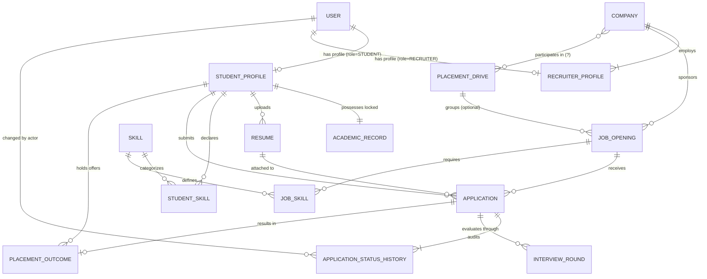

# Conceptual Data Model — College Placement Management System (CPMS)

## 1. Purpose and Scope

### 1.1 Purpose
This document defines the **conceptual database model** for the College Placement Management System (CPMS). As the initial step of Phase 2, this model bridges the requirements analysis and entity inventory established in Phase 1 with the subsequent logical Entity-Relationship (ER) design and physical PostgreSQL schema.

The conceptual model focuses on:
- Identifying core business domains and entity boundaries.
- Formalizing business responsibilities for each entity.
- Defining entity relationships, operational cardinalities, and participation constraints (mandatory vs. optional).
- Enforcing single sources of truth, data integrity boundaries, and institutional business rules.
- Documenting unresolved architectural decisions without premature assumptions.

### 1.2 Scope
- **Domain Coverage:** Identity and authentication, student profiles, academic records and verification, skills and resumes, companies and recruiters, job openings and requirements, placement drives, eligibility criteria, student applications, status auditing, multi-stage interviews, placement offers/outcomes, and dynamic placement analytics.
- **Out of Scope for This Step:** Concrete SQL data types, database-specific constraints (`CHECK`, foreign key syntax), physical indexes, primary key generation strategies, Spring Data JPA annotations, and database migration scripts.

---

## 2. Source Documents Reviewed

The conceptual model directly synthesizes findings and architectural baselines from the following existing project artifacts:

1. **[`README.md`](file:///Users/avilashnegi/Desktop/College_Placement_Management_System/README.md):** Technology stack (PostgreSQL, Java 21, Spring Boot, Spring Data JPA/Hibernate, Next.js), CodeInnov8ors team roles, and four application-level roles (`Student`, `Recruiter`, `Placement Officer`, `Admin`).
2. **[`backend/src/main/resources/application.properties`](file:///Users/avilashnegi/Desktop/College_Placement_Management_System/backend/src/main/resources/application.properties):** Database connection parameters (`placement_db`, `placement_user`), `spring.jpa.hibernate.ddl-auto=none`, and `spring.jpa.open-in-view=false`.
3. **[`docs/database/requirements-analysis.md`](file:///Users/avilashnegi/Desktop/College_Placement_Management_System/docs/database/requirements-analysis.md):** Module-by-module functional analysis, confirmed codebase facts, data ownership boundaries, and application lifecycle pipelines.
4. **[`docs/database/entity-inventory.md`](file:///Users/avilashnegi/Desktop/College_Placement_Management_System/docs/database/entity-inventory.md):** Candidate entity evaluations, inclusion/exclusion justifications, and structural attribute classifications.
5. **[`docs/database/open-questions.md`](file:///Users/avilashnegi/Desktop/College_Placement_Management_System/docs/database/open-questions.md):** Prioritized list of unapproved design proposals regarding role cardinality, drive-to-job associations, eligibility structures, and placement policy enforcement.
6. **Frontend Service and Mock Layers:** Inspected `authService.js`, `recruiterCompanyMockData.js`, `recruiterJobsMockData.js`, `recruiterApplicantsMockData.js`, `studentJobsMockData.js`, and `placementDashboardMockData.js` to extract real-world field semantics and pipeline states.

---

## 3. Proposed Conceptual Entities and Responsibilities

The CPMS conceptual domain is partitioned into five functional areas:

```
┌─────────────────────────────────────────────────────────────────────────┐
│                        1. Identity & Security                           │
│                      [User]  ◄───►  [Role / Enum]                       │
└────────────────────────────────────┬────────────────────────────────────┘
                                     │
         ┌───────────────────────────┴───────────────────────────┐
         ▼                                                       ▼
┌─────────────────────────────────┐             ┌─────────────────────────────────┐
│   2. Student Academic Domain    │             │      3. Corporate Domain        │
│  [StudentProfile]               │             │  [Company]                      │
│        │ (1:1)                  │             │        │ (1:N)                  │
│  [AcademicRecord] (Locked)      │             │  [RecruiterProfile]             │
│        │ (1:N)                  │             └────────────────┬────────────────┘
│  [Resume], [StudentSkill]       │                              │
└────────────────┬────────────────┘                              ▼
                 │                              ┌─────────────────────────────────┐
                 │                              │  4. Placement Operations        │
                 │                              │  [PlacementDrive]               │
                 │                              │        │ (0..1:N)               │
                 │                              │  [JobOpening]                   │
                 │                              └────────────────┬────────────────┘
                 ▼                                               ▼
┌─────────────────────────────────────────────────────────────────────────────────┐
│                      5. Application & Selection Pipeline                        │
│                                [Application]                                    │
│                 ┌────────────────────┴────────────────────┐                     │
│                 ▼                                         ▼                     │
│    [ApplicationStatusHistory]                     [InterviewRound]              │
│                 │                                         │                     │
│                 └────────────────────┬────────────────────┘                     │
│                                      ▼                                          │
│                              [PlacementOutcome]                                 │
└─────────────────────────────────────────────────────────────────────────────────┘
```

### 3.1 Identity and Access Management

#### 1. `User`
- **Purpose:** Represents the foundational authentication credential and account security state for any human interacting with the system.
- **Business Information Represented:** Unique electronic mail login address, securely hashed cryptographic secret (BCrypt/Argon2), account state (`ACTIVE`, `INACTIVE`, `LOCKED`, `PENDING`), creation timestamp, and last login audit record.
- **Why a Separate Entity:** Isolates authentication concerns from mutable biographical profiles. Decoupling allows authentication credentials to change (e.g., password reset, 2FA) without affecting institutional academic records or corporate profiles.
- **Dependency on Unresolved Decision:** Depends on Question 1.1 (Single role attribute vs. `UserRole` association table).

#### 2. `Role` (Conditional Conceptual Entity)
- **Purpose:** Categorizes application-level authorization privileges (`STUDENT`, `RECRUITER`, `PLACEMENT_OFFICER`, `ADMIN`).
- **Business Information Represented:** Standardized role name and descriptive authorization scope.
- **Why It Should or Should Not Be a Separate Entity:**
  - *Included as Entity:* If users can concurrently hold multiple roles (e.g., a student who also serves as a placement coordinator).
  - *Excluded / Handled as Enum Attribute on `User`:* If roles are strictly mutually exclusive, eliminating unnecessary joins.

---

### 3.2 Student and Academic Domain

#### 3. `StudentProfile`
- **Purpose:** Acts as the institutional anchor for an enrolled student seeking campus placement.
- **Business Information Represented:** College roll number / University Seat Number (USN), official legal full name, phone number, alternate contact email, gender, date of birth, residential address, LinkedIn URL, GitHub/portfolio URL, and profile completion tracking indicators.
- **Main Relationships:** Exactly 1:1 with `User`; 1:1 with `AcademicRecord`; 1:N with `Resume`; N:M with `Skill` (via `StudentSkill`); 1:N with `Application`.
- **Why a Separate Entity:** Separates mutable student demographic/contact information from system login credentials (`User`) and placement-locked academic grades (`AcademicRecord`).

#### 4. `AcademicRecord`
- **Purpose:** Represents certified academic performance metrics used to evaluate placement eligibility.
- **Business Information Represented:** Degree program (e.g., B.Tech, MCA), department/branch (e.g., CSE, ECE, IT, MECH), graduation batch year (e.g., 2026), cumulative CGPA (scale 0.00 to 10.00), secondary school (10th) percentage, higher secondary/diploma (12th) percentage, active backlogs count, total cleared backlogs count, verification state (`PENDING`, `VERIFIED`, `REJECTED`), certifying officer identifier, and verification timestamp.
- **Main Relationships:** Mandatory 1:1 with `StudentProfile`. Target of eligibility evaluation rules for `JobOpening` and `PlacementDrive`.
- **Why a Separate Entity:** Academic records require an independent authority model. While students can freely edit their phone number or LinkedIn profile in `StudentProfile`, they **must not** be permitted to modify their CGPA or backlog counts once certified by the Placement Officer. Separating `AcademicRecord` provides a physical boundary for verification locks.

#### 5. `Resume`
- **Purpose:** Manages document metadata and storage references for student resumes.
- **Business Information Represented:** User-defined resume title, file storage URI/path, original file name, MIME type (`application/pdf`), file size in bytes, upload timestamp, and primary/default flag.
- **Main Relationships:** N:1 with `StudentProfile`; 1:N with `Application` (snapshots which resume was submitted for a job).
- **Why a Separate Entity:** Students maintain multiple resume versions tailored to distinct job categories (e.g., Core vs. IT). Binary files reside in filesystem/cloud storage; metadata is tracked here.

#### 6. `Skill` and `StudentSkill`
- **Purpose:** Standardizes recognized technical and professional competencies to support structured candidate filtering.
- **Business Information Represented:** Canonical skill title (e.g., "Java", "React", "PostgreSQL", "Data Analytics"), categorization (Programming Language, Database, Framework), and student proficiency rating (`Beginner`, `Intermediate`, `Advanced`).
- **Main Relationships:** N:M between `StudentProfile` and `Skill` resolved by associative entity `StudentSkill`; N:M between `JobOpening` and `Skill` resolved by `JobSkill`.
- **Why a Separate Entity:** Storing free-form comma-separated strings prevents database-level indexing, leads to spelling discrepancies ("React.js" vs "React"), and impedes automated skill-matching algorithms.

---

### 3.3 Corporate and Recruiter Domain

#### 7. `Company`
- **Purpose:** Models employer organizations participating in campus placements.
- **Business Information Represented:** Official registered company name, corporate website URL, industry sector, corporate location/headquarters, descriptive overview, official campus hiring email, phone number, logo URL/initials, institutional verification status (`PENDING`, `VERIFIED`, `BLOCKED`), and profile completeness.
- **Main Relationships:** 1:N with `RecruiterProfile`; 1:N with `JobOpening`; optional association with `PlacementDrive`.
- **Why a Separate Entity:** The employer organization has an enduring institutional relationship with the college that outlasts individual recruiting personnel. Recruiter logins rotate, but company hiring histories, past package statistics, and corporate ratings must persist.

#### 8. `RecruiterProfile`
- **Purpose:** Links an individual corporate representative's user account to their employer organization.
- **Business Information Represented:** Recruiter's corporate title/designation (e.g., "Talent Acquisition Manager"), corporate direct phone number, and primary campus liaison indicator.
- **Main Relationships:** Mandatory 1:1 with `User`; mandatory N:1 with `Company`.
- **Why a Separate Entity:** Disentangles personal user credentials from corporate identity, allowing multiple recruiters from the same company to access shared company postings and applicants without credential sharing.

---

### 3.4 Placement Operations Domain

#### 9. `PlacementDrive`
- **Purpose:** Represents an organized institutional campus hiring campaign or drive window managed by the placement office.
- **Business Information Represented:** Drive title (e.g., "Campus Recruitment 2026 — Software Engineers"), academic session/batch, scheduled start date, scheduled end date, registration deadline, drive venue/mode (`On-Campus`, `Virtual`, `Pooled`), operational status (`Upcoming`, `Open`, `In Progress`, `Closed`), and institutional instructions.
- **Main Relationships:** Coordinated by `PlacementOfficer` (`User`); associates with participating `Company` entities; groups one or more `JobOpening` records.
- **Why a Separate Entity:** Colleges coordinate placements as institutional events with physical interview room allocations, academic calendar coordination, and strict registration deadlines, which are distinct from continuous open-ended job boards.

#### 10. `JobOpening`
- **Purpose:** Represents a specific vacancy or employment opportunity published by an employer.
- **Business Information Represented:** Job title, role description, work location, employment classification (`Full-time`, `Internship`, `Contract`), salary/CTC display text (e.g., "12 LPA"), structured numeric minimum and maximum salary figures, application deadline timestamp, publication state (`Draft`, `Published`, `Closed`), creation timestamp, and closing timestamp.
- **Eligibility Attributes (Embedded):** Minimum CGPA cutoff, permissible departments/branches, maximum allowable active backlogs, and target graduation year.
- **Main Relationships:** Mandatory N:1 with `Company`; optional N:1 with `PlacementDrive`; 1:N with `Application`; N:M with `Skill` (via `JobSkill`).
- **Why a Separate Entity:** The primary transactional target against which students apply, criteria are evaluated, and recruiters review applicants.

---

### 3.5 Application and Selection Pipeline Domain

#### 11. `Application`
- **Purpose:** Encapsulates the formal submission of a student candidate for a specific job opening.
- **Business Information Represented:** Application submission timestamp, current lifecycle status (`Applied`, `Shortlisted`, `Interview Scheduled`, `Selected`, `Rejected`), reference to submitted resume version, student remarks, internal recruiter notes, and last status modification timestamp.
- **Main Relationships:** Mandatory N:1 with `StudentProfile`; mandatory N:1 with `JobOpening`; N:1 with `Resume`; 1:N with `ApplicationStatusHistory`; 1:N with `InterviewRound`; 1:1 with `PlacementOutcome`.
- **Why a Separate Entity:** The fundamental junction entity that binds the student journey to the recruiter hiring pipeline. Represents the parent entity for all stage assessments and audit records.

#### 12. `ApplicationStatusHistory`
- **Purpose:** Maintains an append-only, tamper-evident audit ledger of every lifecycle transition undergone by an application.
- **Business Information Represented:** Previous status, updated status, timestamp of transition, actor identifier (`User` who performed the update), and optional operational remarks/rejection reasons.
- **Main Relationships:** Mandatory N:1 with `Application`; N:1 with `User` (as actor).
- **Why a Separate Entity:** Campus placements require strict administrative transparency. In cases of dispute (e.g., a student claiming an unfair rejection or unnotified interview drop), the placement office must possess a verifiable, timestamped record of who changed what stage and when. Updating an in-place column destroys historical state.

#### 13. `InterviewRound`
- **Purpose:** Schedules, tracks, and records results for multi-stage technical, behavioral, and aptitude evaluations.
- **Business Information Represented:** Sequential round index (1, 2, 3...), round title (`Aptitude Test`, `Coding Assessment`, `Technical Interview 1`, `HR Interview`), scheduled start date/time, expected duration in minutes, venue/mode (`In-Person Room 302`, `Virtual Teams Link`), interviewer identification, round status (`Scheduled`, `Completed`, `Rescheduled`, `Cancelled`, `No Show`), round outcome (`Pending`, `Cleared`, `Not Cleared`, `On Hold`), and interviewer evaluation notes/scores.
- **Main Relationships:** Mandatory N:1 with `Application`.
- **Why a Separate Entity:** Campus recruitment workflows consistently feature multi-round evaluation funnels. Storing interview details as scalar columns on `Application` violates First Normal Form (1NF) as soon as an applicant advances through multiple interview stages.

#### 14. `PlacementOutcome`
- **Purpose:** Formalizes the final offer, compensation package, and student acceptance decision.
- **Business Information Represented:** Confirmed offered CTC (annualized numeric value), signing bonus/stipend terms, official offer letter document URI, offer extension date, student response deadline date, student decision (`Pending`, `Accepted`, `Declined`, `Revoked`), student decision timestamp, and confirmed date of joining.
- **Main Relationships:** Mandatory 1:1 with successful `Application`; N:1 with `StudentProfile`; N:1 with `Company`.
- **Why a Separate Entity:** An application reaching status `Selected` does not conclude the business transaction. The student must accept or decline the formal offer. Tracking this in a dedicated entity enforces the college's "One Student, One Job" policy: once a `PlacementOutcome` with state `Accepted` is logged, the system automatically restricts the student from applying to subsequent non-dream campus drives.

---

### 3.6 Entity Inclusion and Exclusion Rationale

To maintain an optimal balance between normalization, data integrity, and Spring Boot / JPA performance, candidate entities were evaluated against rigorous inclusion criteria:

| Candidate Entity | Conceptual Decision | Architectural & Domain Justification |
|---|---|---|
| `User` | **Included (Essential)** | Centralizes authentication credentials and login state; prevents duplicating password hashes and security tokens across profile tables. |
| `StudentProfile` | **Included (Essential)** | Separates student personal and contact attributes from authentication credentials and institutional academic marks. |
| `AcademicRecord` | **Included (Essential)** | **Separate from `StudentProfile`** to establish a physical security and locking boundary. Placement Officers certify and lock marks; students cannot modify marks to bypass eligibility gates. |
| `Resume` | **Included (Essential)** | Supports multiple resume versions per student (max 3), tracking metadata while binary files live in storage. Snapshots the specific resume submitted per application. |
| `Skill` / `StudentSkill` | **Included (Recommended)** | Normalizes recognized competencies; eliminates typographical discrepancies ("React.js" vs "React") and enables high-performance candidate-job matching. |
| `Company` | **Included (Essential)** | Models employers independently of transient recruiter logins. Corporate hiring history, past packages, and ratings persist permanently. |
| `RecruiterProfile` | **Included (Essential)** | Links personal recruiter user accounts to their employer company; enables multi-recruiter corporate accounts without credential sharing. |
| `PlacementDrive` | **Included (Essential)** | Models institutional campus hiring campaigns with registration deadlines, venue bookings, and calendar gates, distinct from open job boards. |
| `JobOpening` | **Included (Essential)** | Primary transactional target defining positions, compensation ranges, deadlines, and criteria against which students apply. |
| `EligibilityCriterion` | **Consolidated / Embedded** | **Excluded as a standalone join table.** Embedding structured cutoff columns (`min_cgpa`, `allowed_branches`, `max_active_backlogs`, `batch_year`) directly in `JobOpening` satisfies requirements with zero join overhead. |
| `Application` | **Included (Essential)** | Fundamental transactional junction binding a student to a job opening; enforced with a unique constraint on `(student, job)`. |
| `ApplicationStatusHistory` | **Included (Essential)** | **Required separate entity.** Maintains an append-only, tamper-evident audit ledger for institutional compliance and dispute resolution. Updating an in-place column destroys historical state. |
| `Shortlist` / `Selection` | **Consolidated into `Application`** | **Excluded as separate tables.** Shortlisting and selection are lifecycle states (`Shortlisted`, `Selected`) of an `Application`. Standalone tables would duplicate foreign keys and create synchronization risks. |
| `InterviewRound` | **Included (Essential)** | **Separate from `Application`** to support sequential multi-stage evaluations (Coding, Technical, HR) without violating First Normal Form (1NF). |
| `PlacementOutcome` | **Included (Recommended)** | **Separate from `Application`** to formalize accepted offer terms (offered CTC, offer letter path) and enforce the college's "One Student, One Job" policy. |
| `SystemSetting` | **Deferred** | **Excluded from initial model.** Institutional policies in early phases are static; configuration is maintained in backend application properties until dynamic runtime administration is requested. |
| `PlacementReport` | **Excluded (Derived)** | **Excluded as a persistent table.** Key placement metrics (placement %, average CTC, department statistics) are derived dynamically via SQL aggregation queries and views to prevent data desynchronization. |

---

## 4. Relationship and Cardinality Table

The following table documents conceptual relationships, cardinalities (minimum and maximum instances on both sides), participation constraints, and supporting business rules:

| Source Entity | Cardinality | Target Entity | Participation (Source : Target) | Business Rule Supporting Relationship | Open Decisions / Assumptions |
|---|---|---|---|---|---|
| `User` | **1 : 0..1** | `StudentProfile` | Optional : Mandatory | A `User` with role `STUDENT` must have exactly one student profile. Other roles do not possess a student profile. | Assumes a user cannot be both a student and a recruiter simultaneously. |
| `User` | **1 : 0..1** | `RecruiterProfile` | Optional : Mandatory | A `User` with role `RECRUITER` must have exactly one recruiter profile. | Assumes individual recruiter accounts map to one user identity. |
| `User` | **1 : 0..*** | `Role` / `UserRole` | Mandatory : Mandatory *(if Option B)* | A user must possess at least one role. | **UNRESOLVED (Q1.1):** Defaults to a single role enum attribute directly on `User`. |
| `StudentProfile` | **1 : 1** | `AcademicRecord` | Mandatory : Mandatory | Every student profile must possess exactly one verified academic record tracking marks and backlogs. | None. Separation is necessary for placement office locking. |
| `StudentProfile` | **1 : 0..*** | `Resume` | Optional : Mandatory | A student may upload zero or multiple resumes; each resume belongs strictly to one student. | Assumes maximum 3 resumes per student, with one marked `is_default`. |
| `StudentProfile` | **0..* : 0..*** | `Skill` | Optional : Optional | A student can have multiple skills; a skill can be associated with multiple students (via `StudentSkill`). | Resolved via associative entity `StudentSkill`. |
| `StudentProfile` | **1 : 0..*** | `Application` | Optional : Mandatory | A student may submit multiple job applications; each application belongs strictly to one student. | Submissions permitted only if profile and academics are complete. |
| `StudentProfile` | **1 : 0..*** | `PlacementOutcome` | Optional : Mandatory | A student may receive zero or more job offers over time; each offer belongs to one student. | Enforces institutional "One Student, One Job" placement policy. |
| `Company` | **1 : 1..*** | `RecruiterProfile` | Mandatory : Mandatory | A registered company must have at least one recruiter liaison and may employ many recruiters. | **UNRESOLVED (Q2.1):** Assumes each recruiter belongs strictly to one company. |
| `Company` | **1 : 0..*** | `JobOpening` | Optional : Mandatory | A company may publish multiple job openings; each job belongs strictly to one company. | A company must be in `VERIFIED` status before jobs can be published. |
| `Company` | **0..* : 0..*** | `PlacementDrive` | Optional : Optional | A placement drive may involve multiple companies; a company may participate in multiple drives over time. | **UNRESOLVED (Q1.2):** Assumes drives can be company-specific or multi-company events. |
| `PlacementDrive` | **0..1 : 0..*** | `JobOpening` | Optional : Optional | A job opening may be linked to an overarching placement drive, or stand alone as an independent campus posting. | **UNRESOLVED (Q1.2 & Q1.3):** Direct job application model proposed as default. |
| `JobOpening` | **1 : 0..*** | `Application` | Optional : Mandatory | A job opening receives zero to many applications; each application is bound to exactly one job opening. | Enforced by a unique composite key on `(student_profile_id, job_opening_id)`. |
| `JobOpening` | **0..* : 0..*** | `Skill` | Optional : Optional | A job opening requires multiple skills; a skill can be required by multiple jobs (via `JobSkill`). | Resolved via associative entity `JobSkill`. |
| `Application` | **1 : 1..*** | `ApplicationStatusHistory` | Mandatory : Mandatory | Every application has an audit trail beginning with its initial `Applied` state, followed by all subsequent stage updates. | Insert-only, immutable audit ledger. |
| `Application` | **1 : 0..*** | `InterviewRound` | Optional : Mandatory | Shortlisted applications advance to one or more sequential interview rounds. | Each round tracks distinct schedules, interviewers, and results. |
| `Application` | **1 : 0..1** | `PlacementOutcome` | Optional : Mandatory | A selected application produces at most one formal job offer. | Created when candidate is selected and offer terms are extended. |
| `User` | **1 : 0..*** | `ApplicationStatusHistory` | Optional : Mandatory | A user (recruiter, placement officer, or admin) may record multiple status audit entries over time. | Captures actor responsibility for every status transition. |

---

## 5. Preliminary Conceptual Mermaid Diagram

The following diagram illustrates the conceptual entities and relationships. 

> [!NOTE]
> Relationships marked with `?` or dashed lines represent **unresolved design questions** (such as multi-role support and the direct linkage between `PlacementDrive` and `Company`).



---

## 6. Important Business Rules and Invariants

### 6.1 Identity and Access Control Rules
1. **Application-Level RBAC:** PostgreSQL operates with a single unified application pool user (`placement_user`). Role authorization (`STUDENT`, `RECRUITER`, `PLACEMENT_OFFICER`, `ADMIN`) is enforced at the Spring Security service/controller tier, not via database-level user privileges.
2. **Credential Confidentiality:** Passwords must be cryptographically hashed (BCrypt/Argon2) before entering the database. Plain-text credentials must never be accepted, transmitted, or logged.
3. **Email Uniqueness:** Login email addresses are system-wide unique business identifiers and must be stored in standardized case-insensitive format.

### 6.2 Student Profile and Academic Integrity Rules
4. **Placement Office Academic Authority:** While students own personal contact details, the `AcademicRecord` is strictly verified, modified, and locked by the **Placement Officer**. Once marked `VERIFIED`, students cannot alter their CGPA, backlogs, or marks.
5. **Score Validations:** CGPA must reside within the continuous range of `0.00` to `10.00`. Active and cleared backlog counts must be non-negative integers.
6. **Registration Requirement:** A student cannot apply to any job opening or register for a placement drive unless their `StudentProfile` is marked complete and their `AcademicRecord` has achieved `VERIFIED` status.

### 6.3 Job Posting and Drive Coordination Rules
7. **Company Verification Precondition:** Recruiters cannot publish job postings or participate in placement drives until the placement office has transitioned the `Company` record to `VERIFIED` status.
8. **Chronological Invariants:**
   - For `JobOpening`: `posted_at <= deadline`. Applications are rejected once the deadline timestamp is surpassed.
   - For `PlacementDrive`: `registration_deadline <= start_date <= end_date`.
9. **Status Lifecycle Progression:**
   - Jobs: `Draft` → `Published` → `Closed`.
   - Drives: `Upcoming` → `Open` → `In Progress` → `Closed`.

### 6.4 Application Pipeline and Policy Invariants
10. **Application Uniqueness:** A student can apply **at most once** to any specific `JobOpening`. The combination of `(student_profile_id, job_opening_id)` represents a strictly unique business tuple.
11. **Unified Application Path:** Students apply directly to specific `JobOpening` entities. If an opening is associated with a `PlacementDrive`, applying to the job registers the student under that drive's operational umbrella.
12. **Audit Immutability:** The `ApplicationStatusHistory` ledger is append-only. Updates and deletions are strictly disallowed. Every stage progression must log the previous state, new state, actor ID, and timestamp.
13. **Sequential Interview Advancement:** A candidate can be scheduled for Interview Round *N+1* only if Round *N* has recorded an outcome of `Cleared`.
14. **"One Student, One Job" Policy Enforcement:** Once a student has accepted a formal placement offer in `PlacementOutcome` (`student_response = 'Accepted'`), the system locks the student from submitting further applications, with exceptions granted only for institutional "Dream Company" tiers authorized by the Placement Officer.

---

## 7. Assumptions and Unresolved Questions (Detailed 11-Point Investigation)

The conceptual data model systematically investigates the 11 key design questions identified in Step 3. All proposed defaults are explicitly labeled as **UNAPPROVED PROPOSALS** pending team sign-off:

### 7.1 Question 1: Can users have multiple application roles?
- **Investigation:** Examines whether a user can hold multiple roles simultaneously (e.g., Placement Officer + Administrator).
- **Proposed Default (UNAPPROVED):** **Single role per user (`User.role` enum column: `STUDENT`, `RECRUITER`, `PLACEMENT_OFFICER`, `ADMIN`).**
- **Rationale:** The frontend UI maps each role to a completely distinct dashboard layout and session state (`authService.js`). An individual operates in one primary capacity. If an Admin needs Placement Officer capabilities, the Admin role inherently subsumes operational oversight privileges.
- **Consequence of Choosing a Different Answer:** Requires introducing a `roles` table and `user_roles` associative entity with JPA `@ManyToMany` mapping, adding join overhead to every authenticated request.

### 7.2 Question 2: Can recruiters manage multiple companies?
- **Investigation:** Examines whether a recruiter user account can represent multiple independent hiring organizations.
- **Proposed Default (UNAPPROVED):** **Many-to-one (N:1): Multiple recruiters per company; each recruiter profile is bound to exactly one company.**
- **Rationale:** Campus hiring teams consist of multiple corporate liaisons (HR, technical hiring leads) representing one firm. Third-party staffing agencies representing competing firms under a single college login are not part of campus placement policy.
- **Consequence of Choosing a Different Answer:** Requires an N:M associative table `recruiter_company_mapping` and forces recruiters to pick an active company tenant context for all postings and applicant screening.

### 7.3 Question 3: How do companies relate to jobs and placement drives?
- **Investigation:** Examines ownership and association between employers, postings, and drives.
- **Proposed Default (UNAPPROVED):** **`Company` has a 1:N relationship with `JobOpening`. `Company` associates with `PlacementDrive` either 1:N (for company-specific drives) or N:M (for multi-company campus seasons).**
- **Rationale:** A company owns its job openings directly. Drives serve as institutional coordination wrappers for these postings.
- **Consequence of Choosing a Different Answer:** Decoupling jobs from companies and anchoring them solely to drives would make it impossible to track continuous corporate relationships outside structured drive windows.

### 7.4 Question 4: Can a job opening be associated with a placement drive?
- **Investigation:** Examines whether job openings can exist both within and outside placement drives.
- **Proposed Default (UNAPPROVED):** **Yes, via an optional foreign key (`placement_drive_id`) on `JobOpening` (0..1 : N).**
- **Rationale:** Some opportunities belong to structured campus hiring seasons (e.g., "Day 1 Drive"), while others are off-campus, lateral, or standalone institutional opportunities. Permitting null `placement_drive_id` supports both modes seamlessly.
- **Consequence of Choosing a Different Answer:** If drive containment is mandatory, artificial "placeholder drives" must be created for every single standalone or off-campus posting.

### 7.5 Question 5: Can students apply to jobs directly and through placement drives?
- **Investigation:** Examines whether applications are submitted to drives, jobs, or both.
- **Proposed Default (UNAPPROVED):** **Students apply exclusively to a `JobOpening`. Applying through a drive registers the application against the drive's constituent job opening.**
- **Rationale:** A recruiter screens candidates for a specific role with specific salary and qualifications. A placement drive acts as an umbrella grouping; clicking "Apply" on a drive opportunity submits an application directly to that specific `JobOpening`.
- **Consequence of Choosing a Different Answer:** Allowing separate drive-level and job-level application entities creates duplicate application paths, competing applicant counts, and synchronization nightmares.

### 7.6 Question 6: How are duplicate applications defined and prevented?
- **Investigation:** Examines the business uniqueness constraint for candidate submissions.
- **Proposed Default (UNAPPROVED):** **A unique composite constraint on `(student_profile_id, job_opening_id)`.**
- **Rationale:** A student may apply to multiple distinct jobs within the same company or drive, but can submit **at most one application** to a specific job opening.
- **Consequence of Choosing a Different Answer:** If duplicate checks are evaluated only at the drive level, students cannot apply to multiple distinct profiles (e.g., Software Engineer and Data Analyst) posted by the same employer.

### 7.7 Question 7: Is application status history required as a separate entity?
- **Investigation:** Examines whether in-place status updates suffice or an immutable audit log is required.
- **Proposed Default (UNAPPROVED):** **Yes, `ApplicationStatusHistory` is an essential separate entity.**
- **Rationale:** Campus placements require strict administrative and legal transparency. When disputes arise regarding shortlist drops or interview scheduling, the placement office must possess an immutable, timestamped record of who transitioned the status and why.
- **Consequence of Choosing a Different Answer:** Storing only a single status column on `Application` destroys all historical timeline data and makes dispute investigation impossible.

### 7.8 Question 8: How do interviews and interview rounds relate to applications?
- **Investigation:** Examines the relationship between multi-stage assessments and candidate applications.
- **Proposed Default (UNAPPROVED):** **`InterviewRound` is a child entity of `Application` (`application_id`, `round_number`, `round_name`, `scheduled_at`, `status`, `result`).**
- **Rationale:** Campus interviews are candidate-specific and multi-staged (e.g., Coding Test -> Tech 1 -> Tech 2 -> HR). A 1:N relationship cleanly supports sequential progression and stage feedback without violating 1NF.
- **Consequence of Choosing a Different Answer:** If modeled as drive-level events, tracking individual candidate interview schedules, slot reschedules, and round outcomes becomes decoupled from the candidate's application record.

### 7.9 Question 9: How are shortlisting, final selection, offers, and placements represented?
- **Investigation:** Examines whether shortlists and selections require standalone tables or state transitions.
- **Proposed Default (UNAPPROVED):** **Shortlisting and selection are represented as lifecycle stages within `Application` (`current_status`). Final job offers and student acceptance decisions are formalized in a dedicated `PlacementOutcome` entity.**
- **Rationale:** Shortlisting is transient and part of the hiring funnel. Final offers, however, involve legal salary terms, offer letter document paths, and student acceptance decisions (`Accepted`/`Declined`) that enforce institutional "One Student, One Job" rules.
- **Consequence of Choosing a Different Answer:** Omitting `PlacementOutcome` prevents tracking whether a student accepted or declined an offer and prevents automated enforcement of placement policies.

### 7.10 Question 10: How are eligibility criteria stored and evaluated?
- **Investigation:** Examines structured columns on `JobOpening` vs. a dynamic rules engine table.
- **Proposed Default (UNAPPROVED):** **Structured cutoff columns embedded directly within `JobOpening` (`min_cgpa`, `allowed_branches`, `max_active_backlogs`, `batch_year`).**
- **Rationale:** In existing mock forms (`JobFormModal.js`), recruiters enter minimum CGPA and branch restrictions. Standard placement filtering relies on these exact attributes. Embedding them enables high-performance, indexable queries without complex multi-table joins.
- **Consequence of Choosing a Different Answer:** A separate dynamic criteria table (`eligibility_criteria`) adds significant relational and JPA mapping overhead without providing necessary benefits for standard collegiate criteria.

### 7.11 Question 11: Can placement reports be generated from existing records instead of stored as duplicate statistics?
- **Investigation:** Examines whether placement statistics should be stored in persistent report tables or derived dynamically.
- **Proposed Default (UNAPPROVED):** **Reports and dashboard metrics must be derived dynamically via SQL aggregation queries and analytical views; persistent duplicate report tables are excluded.**
- **Rationale:** Dashboard counters (total students placed, active drives, average package) computed from transactional tables (`student_profiles`, `job_openings`, `applications`, `placement_outcomes`) remain 100% synchronized with ground truth.
- **Consequence of Choosing a Different Answer:** Storing static summary numbers in persistent report tables leads to immediate divergence whenever applications, offers, or student profiles are updated.

---

## 8. Conceptual Validation, Design Risks, and Alternatives

### 8.1 Resolution of Many-to-Many Relationships
The conceptual model identifies four many-to-many relationships that must be properly resolved into associative entities during logical schema design:
1. **`StudentProfile` ── `Skill`:** Resolved via `StudentSkill` (captures student proficiency rating).
2. **`JobOpening` ── `Skill`:** Resolved via `JobSkill` (captures mandatory vs. preferred skill requirements).
3. **`User` ── `Role` (if Multi-Role approved):** Resolved via `UserRole`.
4. **`PlacementDrive` ── `Company` (if Multi-Company Drive approved):** Resolved via `DriveCompany`.

### 8.2 Single Source of Truth and Prevention of Data Duplication
To eliminate data anomalies and desynchronization:
- **Academic Credentials:** Cumulative CGPA and backlog counts reside **solely** in `AcademicRecord`. `JobOpening` and `Application` never store copies of student marks; they evaluate eligibility by joining to `AcademicRecord`.
- **Company Information:** Corporate description, logo, and address reside **solely** in `Company`. `JobOpening` references `company_id` and never duplicates company metadata.
- **Application State:** The active lifecycle status resides in `Application.current_status`. Historical transitions are appended to `ApplicationStatusHistory`. A database trigger or Spring Boot service-layer transactional event guarantees that the two stay synchronized.
- **Placement Reporting:** Placed student counts, placement percentages, and average salary distributions are **never stored as static rows**. They are derived dynamically through SQL aggregation queries and analytical views.

### 8.3 Data Ownership and Boundary Enforcement
- **Student Privacy:** Students can view only their own applications, resumes, and interview schedules. They cannot view peer applications or recruiter internal notes.
- **Corporate Isolation:** Recruiters can view only applicants and interview rounds associated with jobs published by their own company.
- **Administrative Oversight:** Placement Officers and Admins have institutional read/write visibility across all students, drives, companies, and selections.

### 8.4 Spring Data JPA and Hibernate Compatibility Considerations
To ensure seamless mapping in Java 21 / Spring Boot:
- **Surrogate Keys:** Every entity should utilize an unambiguous surrogate primary key (`id`) in the logical schema, paired with natural business unique constraints (e.g., unique `email` on `User`, unique `roll_number` on `StudentProfile`).
- **Avoiding Bidirectional Cascading Hazards:** Relationships such as `Application` → `InterviewRound` and `Application` → `ApplicationStatusHistory` will use parent-managed `@OneToMany(cascade = CascadeType.ALL, orphanRemoval = true)` with foreign keys managed on the child side.
- **Lazy Loading Discipline:** Given `spring.jpa.open-in-view=false`, all associations must default to `FetchType.LAZY`, and service queries will employ explicit `JOIN FETCH` or EntityGraphs to prevent `LazyInitializationException` outside transaction boundaries.

---

## 9. Recommended Next Steps for Creating the ER Diagram

Before proceeding to Step 2 of Phase 2 (Logical ER Diagram and Relational Schema Design):

1. **Team Sign-off on Unapproved Defaults:** Obtain formal approval on:
   - Single-role per user vs. multi-role association.
   - JobOpening-centric application submission path.
   - Structured eligibility cutoff attributes on `JobOpening`.
2. **Cardinality Confirmation:** Confirm whether placement drives are company-specific or multi-company events.
3. **Logical Schema Draft:** Translate this conceptual model into a formal Logical ER Diagram detailing:
   - Primary key naming conventions (e.g., `id BIGSERIAL` or `UUID`).
   - Foreign key constraint definitions and `ON DELETE` actions (`RESTRICT` vs. `CASCADE`).
   - SQL column data types (`VARCHAR`, `NUMERIC(4,2)`, `TIMESTAMPTZ`, `BOOLEAN`).
   - Standardized audit fields (`created_at`, `updated_at`, `created_by`).
