# Entity-Relationship (ER) Diagram — College Placement Management System (CPMS)

## 1. Executive Summary and Scope

This document presents the **Entity-Relationship (ER) Diagram** for the College Placement Management System (CPMS). It directly models the conceptual entities, business rules, and relationship cardinalities established in [`docs/database/conceptual-data-model.md`](file:///Users/avilashnegi/Desktop/College_Placement_Management_System/docs/database/conceptual-data-model.md).

> [!IMPORTANT]
> **Provisional Design Notice:** This ER diagram and its associated cardinalities represent a **provisional design proposal**. Decisions regarding role cardinality, drive-job hierarchy, application uniqueness, and placement policies are proposed defaults pending formal team review and sign-off. Generating this diagram does not imply that design decisions are finalized.

### Key Objectives of this Deliverable:
1. Visually depict all candidate entities and their relational associations using standard Crow's Foot notation.
2. Formulate explicit cardinalities and participation constraints (mandatory vs. optional).
3. Validate critical relationships across identity, academics, corporate hiring, applications, interviews, and placement outcomes.
4. Detail how conceptual many-to-many relationships are resolved through relational associative entities.
5. Catalog all provisional relationships and decisions requiring team approval.

---

## 2. Mermaid Entity-Relationship Diagram

```mermaid
erDiagram
    USER {
        bigserial id PK
        string email UK "Unique login email"
        string password_hash "Salted hash"
        string role "STUDENT, RECRUITER, PLACEMENT_OFFICER, ADMIN"
        string status "ACTIVE, INACTIVE, LOCKED"
        datetime last_login_at
        datetime created_at
        datetime updated_at
    }

    STUDENT_PROFILE {
        bigserial id PK
        bigint user_id FK "Unique - 1:1 with User"
        string roll_number UK "Institutional student ID / USN"
        string full_name
        string phone_number
        string alternate_email
        string gender "Male, Female, Other, Unspecified"
        date date_of_birth
        string current_address
        string linkedin_url
        string github_url
        boolean is_profile_complete
        datetime created_at
        datetime updated_at
    }

    ACADEMIC_RECORD {
        bigserial id PK
        bigint student_profile_id FK "Unique - 1:1 with StudentProfile"
        string degree_program "e.g. B.Tech, MCA"
        string department_branch "e.g. CSE, IT, ECE"
        int graduation_year "e.g. 2026"
        numeric current_cgpa "Scale 0.00 to 10.00"
        numeric tenth_percentage
        numeric twelfth_percentage
        int active_backlogs "Count >= 0"
        int cleared_backlogs
        string verification_status "PENDING, VERIFIED, REJECTED"
        bigint verified_by_user_id FK "Placement Officer"
        datetime verified_at
        datetime created_at
        datetime updated_at
    }

    RESUME {
        bigserial id PK
        bigint student_profile_id FK
        string title "User label (max 3 per student)"
        string file_storage_path "Storage URI"
        string original_file_name
        bigint file_size_bytes
        string mime_type "application/pdf"
        boolean is_default
        datetime uploaded_at
    }

    SKILL {
        bigserial id PK
        string skill_name UK "Standardized canonical name"
        string category "Language, Framework, Database"
        datetime created_at
    }

    STUDENT_SKILL {
        bigserial id PK
        bigint student_profile_id FK
        bigint skill_id FK
        string proficiency_level "Beginner, Intermediate, Advanced"
        datetime created_at
    }

    COMPANY {
        bigserial id PK
        string name UK "Registered corporate name"
        string website_url
        string industry_sector
        string location
        string description
        string contact_email
        string contact_phone
        string logo_url
        string verification_status "PENDING, VERIFIED, BLOCKED"
        datetime created_at
        datetime updated_at
    }

    RECRUITER_PROFILE {
        bigserial id PK
        bigint user_id FK "Unique - 1:1 with User"
        bigint company_id FK "N:1 with Company"
        string designation
        string phone_number
        boolean is_primary_contact
        datetime created_at
        datetime updated_at
    }

    PLACEMENT_DRIVE {
        bigserial id PK
        string title "Campaign title"
        string academic_year "e.g. 2025-2026"
        date start_date
        date end_date
        datetime registration_deadline
        string drive_mode "On-Campus, Virtual, Pooled"
        string status "Upcoming, Open, In Progress, Closed"
        bigint created_by_user_id FK "Placement Officer"
        datetime created_at
        datetime updated_at
    }

    JOB_OPENING {
        bigserial id PK
        bigint company_id FK "Mandatory N:1"
        bigint placement_drive_id FK "Optional N:1 - Provisional"
        string title
        string description
        string job_type "Full-time, Internship, Contract"
        string location
        string salary_text "e.g. 12 LPA"
        numeric min_salary
        numeric max_salary
        datetime application_deadline
        string status "Draft, Published, Closed"
        numeric min_cgpa "Cutoff criteria"
        string allowed_branches "Cutoff criteria"
        int max_active_backlogs "Cutoff criteria"
        int batch_year "Cutoff criteria"
        datetime posted_at
        datetime created_at
        datetime updated_at
    }

    JOB_SKILL {
        bigserial id PK
        bigint job_opening_id FK
        bigint skill_id FK
        boolean is_mandatory
        datetime created_at
    }

    APPLICATION {
        bigserial id PK
        bigint student_profile_id FK
        bigint job_opening_id FK
        bigint resume_id FK "Submitted resume version"
        string current_status "Applied, Shortlisted, Interview Scheduled, Selected, Rejected"
        string student_remarks
        string recruiter_notes
        datetime applied_at
        datetime updated_at
    }

    APPLICATION_STATUS_HISTORY {
        bigserial id PK
        bigint application_id FK
        string from_status
        string to_status
        bigint changed_by_user_id FK "Actor"
        string remarks
        datetime changed_at
    }

    INTERVIEW_ROUND {
        bigserial id PK
        bigint application_id FK
        int round_number "Sequential stage index 1, 2, 3..."
        string round_name "Aptitude, Technical 1, HR"
        datetime scheduled_at
        int duration_minutes
        string interview_mode "In-Person, Video Call, Phone"
        string venue_or_link
        string interviewer_name
        string status "Scheduled, Completed, Rescheduled, Cancelled"
        string result "Pending, Cleared, Not Cleared, On Hold"
        string feedback
        datetime created_at
        datetime updated_at
    }

    PLACEMENT_OUTCOME {
        bigserial id PK
        bigint application_id FK "Unique - 1:1 with Application"
        bigint student_profile_id FK
        bigint company_id FK
        bigint job_opening_id FK
        numeric offered_ctc "Confirmed annual package"
        string offer_letter_url
        date offered_date
        date acceptance_deadline
        string student_response "Pending, Accepted, Declined, Revoked"
        datetime response_date
        date joining_date
        datetime created_at
        datetime updated_at
    }

    %% Identity & Security Relationships
    USER ||--o| STUDENT_PROFILE : "1 to 0..1 (role=STUDENT)"
    USER ||--o| RECRUITER_PROFILE : "1 to 0..1 (role=RECRUITER)"
    USER ||--o{ PLACEMENT_DRIVE : "created by (role=PLACEMENT_OFFICER)"
    USER ||--o{ ACADEMIC_RECORD : "verified by (role=PLACEMENT_OFFICER)"
    USER ||--o{ APPLICATION_STATUS_HISTORY : "status changed by actor"

    %% Student Academic Domain Relationships
    STUDENT_PROFILE ||--|| ACADEMIC_RECORD : "1 to 1 (locked credentials)"
    STUDENT_PROFILE ||--o{ RESUME : "uploads 0..3 resumes"
    STUDENT_PROFILE ||--o{ STUDENT_SKILL : "declares"
    SKILL ||--o{ STUDENT_SKILL : "categorizes"
    STUDENT_PROFILE ||--o{ APPLICATION : "submits"
    STUDENT_PROFILE ||--o{ PLACEMENT_OUTCOME : "receives"

    %% Corporate & Recruiter Domain Relationships
    COMPANY ||--|{ RECRUITER_PROFILE : "employs 1..N recruiters"
    COMPANY ||--o{ JOB_OPENING : "publishes"
    COMPANY ||--o{ PLACEMENT_OUTCOME : "extends offers"

    %% Placement Operations Relationships
    PLACEMENT_DRIVE ||--o{ JOB_OPENING : "groups (optional 0..1 to 0..N)"

    %% Job Openings & Requirements Relationships
    JOB_OPENING ||--o{ JOB_SKILL : "specifies"
    SKILL ||--o{ JOB_SKILL : "required by"
    JOB_OPENING ||--o{ APPLICATION : "receives candidate submissions"
    JOB_OPENING ||--o{ PLACEMENT_OUTCOME : "produces hires"

    %% Application & Pipeline Relationships
    RESUME ||--o{ APPLICATION : "attached snapshot"
    APPLICATION ||--|{ APPLICATION_STATUS_HISTORY : "audits 1 to 1..N"
    APPLICATION ||--o{ INTERVIEW_ROUND : "evaluates 1 to 0..N"
    APPLICATION ||--o| PLACEMENT_OUTCOME : "results in 1 to 0..1"
```

---

## 3. Diagram Explanation and Structural Overview

The ER diagram structures the campus placement process across five interacting subsystems:

1. **Identity & Authorization Subsystem (`USER`):** Encapsulates authentication credentials and role definitions (`STUDENT`, `RECRUITER`, `PLACEMENT_OFFICER`, `ADMIN`). It acts as the root parent for role-specific profile extensions.
2. **Student & Academics Subsystem (`STUDENT_PROFILE`, `ACADEMIC_RECORD`, `RESUME`, `SKILL`, `STUDENT_SKILL`):** Captures personal demographics, locked academic credentials, uploaded resumes, and technical competencies.
3. **Corporate & Recruiter Subsystem (`COMPANY`, `RECRUITER_PROFILE`):** Captures verified hiring organizations and individual recruiter accounts.
4. **Placement Operations Subsystem (`PLACEMENT_DRIVE`, `JOB_OPENING`, `JOB_SKILL`):** Models institutional recruitment campaigns, individual job postings, and embedded eligibility cutoff thresholds.
5. **Application & Selection Funnel (`APPLICATION`, `APPLICATION_STATUS_HISTORY`, `INTERVIEW_ROUND`, `PLACEMENT_OUTCOME`):** Coordinates candidate submissions, immutable audit tracking, multi-round interview evaluations, and accepted placement packages.

---

## 4. Relationship Summary and Cardinality Table

The following table summarizes all relationships depicted in the diagram, their cardinalities, participation optionality, and supporting business rules:

| Source Entity | Cardinality | Target Entity | Source Participation | Target Participation | Business Rule & Relationship Semantic | Provisional Status |
|---|---|---|---|---|---|---|
| `USER` | **1 : 0..1** | `STUDENT_PROFILE` | Mandatory | Optional | A user with role `STUDENT` must instantiate exactly one profile. Non-student accounts possess zero student profiles. | Proposed Default (Q1) |
| `USER` | **1 : 0..1** | `RECRUITER_PROFILE` | Mandatory | Optional | A user with role `RECRUITER` must instantiate exactly one recruiter profile. Non-recruiter accounts possess zero recruiter profiles. | Proposed Default (Q1) |
| `USER` | **1 : 0..N** | `PLACEMENT_DRIVE` | Mandatory | Optional | Tracks the Placement Officer account who created and scheduled the placement drive. | Confirmed |
| `USER` | **1 : 0..N** | `ACADEMIC_RECORD` | Optional | Optional | Identifies the Placement Officer who verified and locked a student's academic marks. | Confirmed |
| `USER` | **1 : 0..N** | `APPLICATION_STATUS_HISTORY` | Mandatory | Optional | Records the actor (recruiter, placement officer, or admin) who transitioned an application's stage. | Confirmed |
| `STUDENT_PROFILE` | **1 : 1** | `ACADEMIC_RECORD` | Mandatory | Mandatory | Every student possesses exactly one verified academic record. Separated to establish an administrative locking boundary. | Confirmed |
| `STUDENT_PROFILE` | **1 : 0..N** | `RESUME` | Mandatory | Optional | A student may maintain zero to 3 resumes; one is designated as `is_default`. | Confirmed |
| `STUDENT_PROFILE` | **1 : 0..N** | `APPLICATION` | Mandatory | Optional | A student can apply to multiple distinct job opportunities. | Confirmed |
| `STUDENT_PROFILE` | **1 : 0..N** | `PLACEMENT_OUTCOME` | Mandatory | Optional | Tracks formal employment offers extended to and accepted by the student. | Confirmed |
| `COMPANY` | **1 : 1..N** | `RECRUITER_PROFILE` | Mandatory | Mandatory | An employer company must have at least one recruiter liaison and may employ multiple corporate recruiters. | Proposed Default (Q2) |
| `COMPANY` | **1 : 0..N** | `JOB_OPENING` | Mandatory | Optional | An employer company may publish zero to many job openings. | Confirmed |
| `PLACEMENT_DRIVE` | **0..1 : 0..N** | `JOB_OPENING` | Optional | Optional | A job opening may be grouped under an overarching campus drive, or stand alone as an off-campus/direct posting. | Proposed Default (Q3 & Q4) |
| `JOB_OPENING` | **1 : 0..N** | `APPLICATION` | Mandatory | Optional | A job opening receives zero to many candidate applications. | Confirmed |
| `RESUME` | **1 : 0..N** | `APPLICATION` | Mandatory | Optional | An application snapshots the exact resume version submitted at application time. | Confirmed |
| `APPLICATION` | **1 : 1..N** | `APPLICATION_STATUS_HISTORY` | Mandatory | Mandatory | Every application has an append-only audit trail beginning with its initial `Applied` state. | Confirmed |
| `APPLICATION` | **1 : 0..N** | `INTERVIEW_ROUND` | Mandatory | Optional | Shortlisted candidates advance through zero to many sequential interview evaluation rounds. | Confirmed |
| `APPLICATION` | **1 : 0..1** | `PLACEMENT_OUTCOME` | Mandatory | Optional | A successful application produces at most one formal job offer. | Confirmed |

---

## 5. Detailed Validation of Critical Relationships

### 5.1 User and Application-Role Relationships
- **Current Model:** 1:0..1 optional extension from `USER` to `STUDENT_PROFILE` and `RECRUITER_PROFILE`, with the active role stored as a discrete enumerated attribute on `USER`.
- **Validation:** The frontend routing (`authService.js`) maps each user strictly to one primary dashboard (`/student/dashboard`, `/recruiter/dashboard`, `/placement/dashboard`, `/admin/dashboard`). Restricting each account to a single active role eliminates join overhead and simplifies session management.
- **Provisional Alternative:** If staff require concurrent multi-role capabilities (e.g., a faculty member who is both a Placement Officer and an Administrator), a normalized `ROLE` entity and `USER_ROLE` associative table must be introduced.

### 5.2 Student and Academic-Record Relationships
- **Current Model:** Strict 1:1 relationship between `STUDENT_PROFILE` and `ACADEMIC_RECORD`.
- **Validation:** Maintaining `ACADEMIC_RECORD` as an independent entity from `STUDENT_PROFILE` is essential. While students have update permissions over personal contact data (phone, address, portfolio URLs), certified academic metrics (CGPA, 10th/12th marks, active backlogs) must be **locked by the Placement Officer** (`verification_status = 'VERIFIED'`). Physical entity separation guarantees that personal profile updates cannot tamper with verified academic eligibility criteria.

### 5.3 Company, Recruiter, Job, and Placement Drive Relationships
- **Current Model:**
  - `COMPANY` (1) ── (1..N) `RECRUITER_PROFILE`
  - `COMPANY` (1) ── (0..N) `JOB_OPENING`
  - `PLACEMENT_DRIVE` (0..1) ── (0..N) `JOB_OPENING`
- **Validation:** Employers frequently deploy multiple recruiters (e.g., technical leads and HR specialists) to manage a single campus season. The N:1 relationship between `RECRUITER_PROFILE` and `COMPANY` allows all recruiters from a company to share access to candidate pools without sharing login credentials.
- **Drive Linkage:** Permitting `JOB_OPENING.placement_drive_id` to be nullable allows CPMS to support both structured campus drives (e.g., "Day 1 Mega Drive") and standalone, direct, or off-campus recruitment postings without creating artificial dummy drives.

### 5.4 Student and Application Relationships & Uniqueness Definition
- **Current Model:** `STUDENT_PROFILE` (1) ── (0..N) `APPLICATION`.
- **Uniqueness Constraint:** Proposed as a unique composite business key on `(student_profile_id, job_opening_id)`.
- **Validation:** A student may apply to multiple distinct jobs across different companies (or multiple distinct roles within the same company), but cannot submit duplicate applications to the exact same job opening.

### 5.5 Business Process Comparison: Job Applications vs. Drive Applications
A critical question investigated during modeling is whether *job applications* and *drive applications* represent distinct business processes:
- **Analysis:**
  - In a college placement system, recruiters hire for specific roles with specific job titles, compensation packages, and criteria.
  - Placement drives represent an operational grouping (a campus visit date, interview room reservations, registration deadlines) rather than an employer vacancy.
- **Conclusion:** **They represent the same business process.** Students apply directly to a `JOB_OPENING`. When browsing opportunities grouped under a `PLACEMENT_DRIVE`, applying to a job within that drive automatically enrolls the student under that drive's operational schedule. Introducing separate "drive registrations" and "job applications" would create two competing transactional records for the same hiring opportunity, doubling state-machine complexity.

### 5.6 Application and Status History Relationships
- **Current Model:** `APPLICATION` (1) ── (1..N) `APPLICATION_STATUS_HISTORY`.
- **Validation:** Campus placements require strict institutional transparency and dispute auditability. Updating an in-place column destroys historical timelines. The 1:N append-only history table guarantees that every transition (from `Applied` to `Shortlisted`, `Interview Scheduled`, `Selected`, or `Rejected`) permanently records the timestamp, actor ID (`changed_by_user_id`), and operational comments.

### 5.7 Application and Interview Round Relationships
- **Current Model:** `APPLICATION` (1) ── (0..N) `INTERVIEW_ROUND`.
- **Validation:** Campus recruitment workflows consistently feature multi-round evaluation pipelines (e.g., Round 1: Coding Assessment -> Round 2: Technical Interview -> Round 3: HR Interview). Storing interview details directly on `APPLICATION` violates First Normal Form (1NF). The 1:N relationship with a unique sequence key `(application_id, round_number)` allows sequential scheduling, stage-specific feedback, and independent round results (`Cleared`, `Not Cleared`, `On Hold`).

### 5.8 Shortlisting, Selection, Offers, and Placement Outcomes
- **Current Model:** Shortlisting and selection are tracked as stage states (`current_status = 'Shortlisted'`, `'Selected'`) on `APPLICATION`. Formal employment offers and acceptance decisions are formalized in `PLACEMENT_OUTCOME` (1:0..1 with `APPLICATION`).
- **Validation:** Shortlisting is an intermediate filtering stage that does not require a separate table. However, final selection involves legal terms: confirmed annual package (CTC), offer letter document storage, and student decision (`Accepted`/`Declined`). A dedicated `PLACEMENT_OUTCOME` entity provides a clean single source of truth for placed students and enables the system to enforce the college's "One Student, One Job" policy (locking placed students from subsequent non-dream company drives).

---

## 6. Resolution of Many-to-Many Relationships

The conceptual model identified several many-to-many relationships that are explicitly resolved into associative relational entities:

### 6.1 Student Skills (`STUDENT_PROFILE` ── `SKILL`)
- **Conceptual Need:** A student possesses multiple skills; a skill is shared by multiple students.
- **Relational Resolution:** Resolved via `STUDENT_SKILL` associative entity.
- **Attributes:** `id`, `student_profile_id`, `skill_id`, `proficiency_level` (`Beginner`, `Intermediate`, `Advanced`), `created_at`.
- **Uniqueness:** Composite unique constraint on `(student_profile_id, skill_id)`.

### 6.2 Job Skills (`JOB_OPENING` ── `SKILL`)
- **Conceptual Need:** A job opening specifies multiple required/preferred skills; a skill is required by multiple postings.
- **Relational Resolution:** Resolved via `JOB_SKILL` associative entity.
- **Attributes:** `id`, `job_opening_id`, `skill_id`, `is_mandatory` (boolean distinguishing core requirements from preferred skills), `created_at`.
- **Uniqueness:** Composite unique constraint on `(job_opening_id, skill_id)`.

---

## 7. Unresolved Questions and Provisional Relationships

The following relationships and boundaries are modeled as **provisional proposals** and require formal team sign-off:

| # | Domain Area | Provisional Proposal | Alternative Option | Impact if Alternative Selected |
|---|---|---|---|---|
| 1 | **User Roles** | Single role enum on `USER` (`role`) | Normalized `ROLES` and `USER_ROLES` tables | Adds join table to every authenticated request; required only if staff hold concurrent roles. |
| 2 | **Drive-Job Linkage** | Optional FK `placement_drive_id` on `JOB_OPENING` | Strict mandatory drive containment | Requires generating artificial dummy drives for off-campus and standalone postings. |
| 3 | **Drive Scope** | 1:N between `PLACEMENT_DRIVE` and `JOB_OPENING` | N:M via `DRIVE_COMPANIES` | Necessary only if a single drive represents an umbrella event grouping 50+ companies simultaneously. |
| 4 | **Recruiter Cardinality** | N:1 (`RECRUITER_PROFILE` belongs to 1 `COMPANY`) | N:M via `RECRUITER_COMPANIES` | Required only if external recruitment agency staff represent multiple competing employers. |
| 5 | **Eligibility Storage** | Embedded cutoff attributes on `JOB_OPENING` | Dynamic `ELIGIBILITY_CRITERIA` rules table | High query complexity; warranted only if non-standard composite boolean rules are required. |
| 6 | **Application Uniqueness**| Unique `(student, job)` | Drive-level uniqueness only | If enforced at drive level, students cannot apply to multiple distinct openings in the same drive. |

---

## 8. Design Decisions Requiring Team Approval

The database developer recommends the following decisions for formal team review and sign-off:

1. **Approval of Single Role Model:** Confirm that platform users operate under a single application role at any given time.
2. **Approval of Job-Centric Application Flow:** Confirm that student submissions are directed to specific `JOB_OPENING` records, with placement drives acting as optional scheduling wrappers.
3. **Approval of Academic Record Locking Boundary:** Confirm that students cannot self-certify academic marks, and that only Placement Officers possess privileges to transition `academic_records.verification_status` to `VERIFIED`.
4. **Approval of "One Student, One Job" Policy Enforcement:** Confirm that accepting an offer in `PLACEMENT_OUTCOME` should restrict future applications unless granted a placement cell exception.

---

## 9. Physical Implementation Mapping

The ER diagram documented here maps directly to the following implementation files:
- **DDL Schema Script:** [`database/schema.sql`](file:///Users/avilashnegi/Desktop/College_Placement_Management_System/database/schema.sql)
- **Seed Test Data:** [`database/seed-data.sql`](file:///Users/avilashnegi/Desktop/College_Placement_Management_System/database/seed-data.sql)
- **Relational Data Dictionary:** [`docs/database/logical-data-model.md`](file:///Users/avilashnegi/Desktop/College_Placement_Management_System/docs/database/logical-data-model.md)
