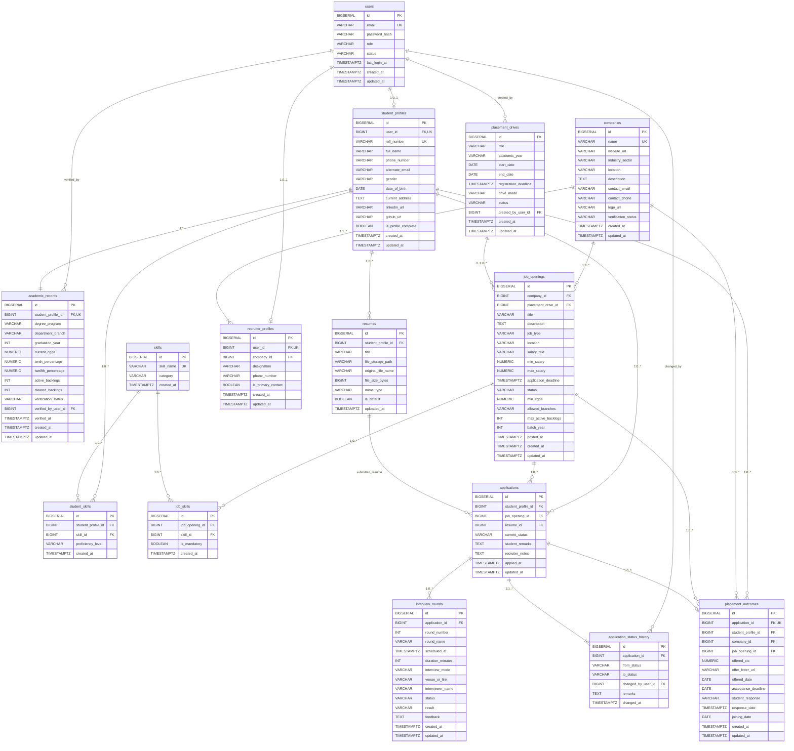

# Logical Data Model — College Placement Management System (CPMS)

## 1. Executive Summary

This document specifies the **Logical Data Model** for the College Placement Management System (CPMS). It formalizes the conceptual entities, business rules, and relationship cardinalities defined in [`docs/database/conceptual-data-model.md`](file:///Users/avilashnegi/Desktop/College_Placement_Management_System/docs/database/conceptual-data-model.md) into concrete relational specifications optimized for **PostgreSQL 14+** and **Spring Data JPA / Hibernate**.

### Key Architectural Decisions Applied:
1. **Surrogate Keys with Business Constraints:** Every table utilizes an unambiguous surrogate primary key (`id BIGSERIAL`), paired with unique natural candidate keys (e.g., `uq_users_email`, `uq_students_roll_number`, `uq_applications_student_job`). This ensures high-performance joins, eliminates composite foreign key chains in JPA, and supports Hibernate's identity generation strategy (`GenerationType.IDENTITY`).
2. **String-Enumerated Attributes with Check Constraints:** Lifecycle statuses and application roles are represented as `VARCHAR(30)` or `VARCHAR(50)` enforced with SQL `CHECK` constraints. This guarantees database-level integrity while allowing clean mapping to Java enums via `@Enumerated(EnumType.STRING)` without requiring PostgreSQL-specific custom user types.
3. **Audit Trail Standardization:** Every core table includes standard `created_at` and `updated_at` timestamps using `TIMESTAMPTZ` (UTC). An automated PostgreSQL trigger updates `updated_at` on modification.
4. **Referential Integrity and Delete Rules:** Cascade deletes (`ON DELETE CASCADE`) are restricted to pure child compositions (e.g., `academic_records`, `interview_rounds`, `application_status_history`). Core business entities (`companies`, `job_openings`, `student_profiles`) employ `ON DELETE RESTRICT` to prevent accidental loss of historical placement outcomes.

---

## 2. Relational Data Dictionary

### 2.1 Identity and Access Management

#### Table: `users`
Central identity repository for all system actors.

| Column Name | PostgreSQL Data Type | Nullable | Default | Constraints | Description |
|---|---|---|---|---|---|
| `id` | `BIGSERIAL` | No | Auto | `pk_users` | Primary key surrogate identifier. |
| `email` | `VARCHAR(255)` | No | None | `uq_users_email` | Unique login email (stored lowercase). |
| `password_hash` | `VARCHAR(255)` | No | None | None | Salted cryptographic hash (BCrypt/Argon2). |
| `role` | `VARCHAR(30)` | No | None | `chk_users_role` | Permitted: `STUDENT`, `RECRUITER`, `PLACEMENT_OFFICER`, `ADMIN`. |
| `status` | `VARCHAR(30)` | No | `'ACTIVE'` | `chk_users_status` | Permitted: `ACTIVE`, `INACTIVE`, `LOCKED`, `PENDING_VERIFICATION`. |
| `last_login_at` | `TIMESTAMPTZ` | Yes | `NULL` | None | Timestamp of most recent authentication. |
| `created_at` | `TIMESTAMPTZ` | No | `CURRENT_TIMESTAMP` | None | Account creation timestamp. |
| `updated_at` | `TIMESTAMPTZ` | No | `CURRENT_TIMESTAMP` | None | Timestamp of last record update. |

---

### 2.2 Student Profiles, Academics, Resumes, and Skills

#### Table: `student_profiles`
Biographical and demographic details for students.

| Column Name | PostgreSQL Data Type | Nullable | Default | Constraints | Description |
|---|---|---|---|---|---|
| `id` | `BIGSERIAL` | No | Auto | `pk_student_profiles` | Primary key surrogate identifier. |
| `user_id` | `BIGINT` | No | None | `fk_students_user`, `uq_students_user` | References `users(id)` (1:1 relationship). |
| `roll_number` | `VARCHAR(50)` | No | None | `uq_students_roll_number` | Institutional student ID / USN. |
| `full_name` | `VARCHAR(150)` | No | None | None | Legal student name. |
| `phone_number` | `VARCHAR(20)` | No | None | None | Contact mobile number. |
| `alternate_email` | `VARCHAR(255)` | Yes | `NULL` | None | Personal secondary email. |
| `gender` | `VARCHAR(20)` | Yes | `NULL` | `chk_students_gender` | Permitted: `Male`, `Female`, `Other`, `Prefer not to say`. |
| `date_of_birth` | `DATE` | Yes | `NULL` | None | Date of birth for age verification. |
| `current_address` | `TEXT` | Yes | `NULL` | None | Residential address. |
| `linkedin_url` | `VARCHAR(255)` | Yes | `NULL` | None | Public LinkedIn profile URL. |
| `github_url` | `VARCHAR(255)` | Yes | `NULL` | None | Portfolio / GitHub URL. |
| `is_profile_complete` | `BOOLEAN` | No | `FALSE` | None | Quick flag for placement eligibility gates. |
| `created_at` | `TIMESTAMPTZ` | No | `CURRENT_TIMESTAMP` | None | Profile registration timestamp. |
| `updated_at` | `TIMESTAMPTZ` | No | `CURRENT_TIMESTAMP` | None | Timestamp of last record update. |

#### Table: `academic_records`
Locked academic performance records verified by Placement Officers.

| Column Name | PostgreSQL Data Type | Nullable | Default | Constraints | Description |
|---|---|---|---|---|---|
| `id` | `BIGSERIAL` | No | Auto | `pk_academic_records` | Primary key surrogate identifier. |
| `student_profile_id` | `BIGINT` | No | None | `fk_academic_student`, `uq_academic_student` | References `student_profiles(id)` (1:1). |
| `degree_program` | `VARCHAR(100)` | No | None | None | Degree enrolled (e.g., `B.Tech`, `MCA`, `M.Tech`). |
| `department_branch` | `VARCHAR(100)` | No | None | None | Department (e.g., `CSE`, `ECE`, `IT`, `MECH`). |
| `graduation_year` | `INT` | No | None | `chk_academic_grad_year` | Expected graduation year (e.g., 2026). |
| `current_cgpa` | `NUMERIC(4,2)` | No | `0.00` | `chk_academic_cgpa` | CGPA scale 0.00 to 10.00. |
| `tenth_percentage` | `NUMERIC(5,2)` | Yes | `NULL` | `chk_academic_tenth` | Secondary school % (0.00 to 100.00). |
| `twelfth_percentage`| `NUMERIC(5,2)` | Yes | `NULL` | `chk_academic_twelfth` | Higher secondary/Diploma % (0.00 to 100.00). |
| `active_backlogs` | `INT` | No | `0` | `chk_academic_backlogs` | Count of uncleared backlogs (`>= 0`). |
| `cleared_backlogs` | `INT` | No | `0` | None | Count of cleared backlogs. |
| `verification_status`| `VARCHAR(30)` | No | `'PENDING'` | `chk_academic_status` | Permitted: `PENDING`, `VERIFIED`, `REJECTED`. |
| `verified_by_user_id`| `BIGINT` | Yes | `NULL` | `fk_academic_verified_by`| References `users(id)` (Placement Officer). |
| `verified_at` | `TIMESTAMPTZ` | Yes | `NULL` | None | Timestamp when academic record was locked. |
| `created_at` | `TIMESTAMPTZ` | No | `CURRENT_TIMESTAMP` | None | Record creation timestamp. |
| `updated_at` | `TIMESTAMPTZ` | No | `CURRENT_TIMESTAMP` | None | Timestamp of last record update. |

#### Table: `resumes`
Metadata and file paths for student resumes.

| Column Name | PostgreSQL Data Type | Nullable | Default | Constraints | Description |
|---|---|---|---|---|---|
| `id` | `BIGSERIAL` | No | Auto | `pk_resumes` | Primary key surrogate identifier. |
| `student_profile_id` | `BIGINT` | No | None | `fk_resumes_student` | References `student_profiles(id)`. |
| `title` | `VARCHAR(150)` | No | None | None | Student label (e.g., "FullStack Resume 2026"). |
| `file_storage_path` | `VARCHAR(500)` | No | None | None | Relative filesystem or cloud storage URI. |
| `original_file_name`| `VARCHAR(255)` | No | None | None | Original upload filename. |
| `file_size_bytes` | `BIGINT` | No | None | None | File size in bytes. |
| `mime_type` | `VARCHAR(100)` | No | `'application/pdf'` | None | Document content type. |
| `is_default` | `BOOLEAN` | No | `FALSE` | None | Indicates student's primary resume. |
| `uploaded_at` | `TIMESTAMPTZ` | No | `CURRENT_TIMESTAMP` | None | Upload timestamp. |

#### Table: `skills`
Master catalog of recognized skills.

| Column Name | PostgreSQL Data Type | Nullable | Default | Constraints | Description |
|---|---|---|---|---|---|
| `id` | `BIGSERIAL` | No | Auto | `pk_skills` | Primary key surrogate identifier. |
| `skill_name` | `VARCHAR(100)` | No | None | `uq_skills_name` | Canonical skill name (unique, e.g., "Java"). |
| `category` | `VARCHAR(50)` | Yes | `NULL` | None | E.g., `Programming Language`, `Database`, `DevOps`. |
| `created_at` | `TIMESTAMPTZ` | No | `CURRENT_TIMESTAMP` | None | Catalog entry creation timestamp. |

#### Table: `student_skills`
Associative table linking students to skills.

| Column Name | PostgreSQL Data Type | Nullable | Default | Constraints | Description |
|---|---|---|---|---|---|
| `id` | `BIGSERIAL` | No | Auto | `pk_student_skills` | Primary key surrogate identifier. |
| `student_profile_id` | `BIGINT` | No | None | `fk_ss_student` | References `student_profiles(id)`. |
| `skill_id` | `BIGINT` | No | None | `fk_ss_skill` | References `skills(id)`. |
| `proficiency_level` | `VARCHAR(30)` | Yes | `'Intermediate'` | `chk_ss_proficiency` | Permitted: `Beginner`, `Intermediate`, `Advanced`. |
| `created_at` | `TIMESTAMPTZ` | No | `CURRENT_TIMESTAMP` | None | Association creation timestamp. |

*Unique Constraint:* `uq_student_skills_pair (student_profile_id, skill_id)`

---

### 2.3 Companies and Recruiters

#### Table: `companies`
Employer organizations participating in campus hiring.

| Column Name | PostgreSQL Data Type | Nullable | Default | Constraints | Description |
|---|---|---|---|---|---|
| `id` | `BIGSERIAL` | No | Auto | `pk_companies` | Primary key surrogate identifier. |
| `name` | `VARCHAR(200)` | No | None | `uq_companies_name` | Registered corporate name. |
| `website_url` | `VARCHAR(255)` | Yes | `NULL` | None | Public website URL. |
| `industry_sector` | `VARCHAR(100)` | No | None | None | E.g., `Information Technology`, `Data Analytics`. |
| `location` | `VARCHAR(150)` | No | None | None | Headquarters or primary hiring base. |
| `description` | `TEXT` | Yes | `NULL` | None | Corporate overview. |
| `contact_email` | `VARCHAR(255)` | No | None | None | Campus recruiting official mailbox. |
| `contact_phone` | `VARCHAR(30)` | Yes | `NULL` | None | Campus recruiting contact phone. |
| `logo_url` | `VARCHAR(500)` | Yes | `NULL` | None | Hosted company logo URL. |
| `verification_status`| `VARCHAR(30)` | No | `'PENDING'` | `chk_companies_status`| Permitted: `PENDING`, `VERIFIED`, `BLOCKED`. |
| `created_at` | `TIMESTAMPTZ` | No | `CURRENT_TIMESTAMP` | None | Organization registration timestamp. |
| `updated_at` | `TIMESTAMPTZ` | No | `CURRENT_TIMESTAMP` | None | Timestamp of last record update. |

#### Table: `recruiter_profiles`
Associates recruiter logins with their employer company.

| Column Name | PostgreSQL Data Type | Nullable | Default | Constraints | Description |
|---|---|---|---|---|---|
| `id` | `BIGSERIAL` | No | Auto | `pk_recruiter_profiles` | Primary key surrogate identifier. |
| `user_id` | `BIGINT` | No | None | `fk_recruiters_user`, `uq_recruiters_user` | References `users(id)` (1:1). |
| `company_id` | `BIGINT` | No | None | `fk_recruiters_company` | References `companies(id)` (N:1). |
| `designation` | `VARCHAR(100)` | Yes | `NULL` | None | Title (e.g., "Campus Talent Lead"). |
| `phone_number` | `VARCHAR(20)` | Yes | `NULL` | None | Direct contact phone. |
| `is_primary_contact` | `BOOLEAN` | No | `FALSE` | None | Indicates primary college liaison. |
| `created_at` | `TIMESTAMPTZ` | No | `CURRENT_TIMESTAMP` | None | Profile creation timestamp. |
| `updated_at` | `TIMESTAMPTZ` | No | `CURRENT_TIMESTAMP` | None | Timestamp of last record update. |

---

### 2.4 Placement Operations (Drives, Jobs, Requirements)

#### Table: `placement_drives`
Institutional recruitment campaigns coordinated by the placement office.

| Column Name | PostgreSQL Data Type | Nullable | Default | Constraints | Description |
|---|---|---|---|---|---|
| `id` | `BIGSERIAL` | No | Auto | `pk_placement_drives` | Primary key surrogate identifier. |
| `title` | `VARCHAR(200)` | No | None | None | Drive title (e.g., "Campus Drive 2026"). |
| `academic_year` | `VARCHAR(20)` | No | None | None | Academic session (e.g., "2025-2026"). |
| `start_date` | `DATE` | No | None | None | Scheduled start date. |
| `end_date` | `DATE` | No | None | `chk_drive_dates` | Scheduled end date (`>= start_date`). |
| `registration_deadline`| `TIMESTAMPTZ` | No | None | None | Student application cutoff for the drive. |
| `drive_mode` | `VARCHAR(30)` | No | `'On-Campus'` | `chk_drive_mode` | Permitted: `On-Campus`, `Virtual`, `Pooled`. |
| `status` | `VARCHAR(30)` | No | `'Upcoming'` | `chk_drive_status` | Permitted: `Upcoming`, `Open`, `In Progress`, `Closed`. |
| `created_by_user_id` | `BIGINT` | No | None | `fk_drives_creator` | References `users(id)` (Placement Officer). |
| `created_at` | `TIMESTAMPTZ` | No | `CURRENT_TIMESTAMP` | None | Drive creation timestamp. |
| `updated_at` | `TIMESTAMPTZ` | No | `CURRENT_TIMESTAMP` | None | Timestamp of last record update. |

#### Table: `job_openings`
Specific employment openings published by companies.

| Column Name | PostgreSQL Data Type | Nullable | Default | Constraints | Description |
|---|---|---|---|---|---|
| `id` | `BIGSERIAL` | No | Auto | `pk_job_openings` | Primary key surrogate identifier. |
| `company_id` | `BIGINT` | No | None | `fk_jobs_company` | References `companies(id)`. |
| `placement_drive_id` | `BIGINT` | Yes | `NULL` | `fk_jobs_drive` | References `placement_drives(id)` (optional). |
| `title` | `VARCHAR(150)` | No | None | None | Position title (e.g., "Graduate Engineer"). |
| `description` | `TEXT` | No | None | None | Detailed role responsibilities. |
| `job_type` | `VARCHAR(30)` | No | `'Full-time'` | `chk_jobs_type` | Permitted: `Full-time`, `Internship`, `Contract`. |
| `location` | `VARCHAR(100)` | No | None | None | City / Onsite location or `Remote`. |
| `salary_text` | `VARCHAR(100)` | Yes | `NULL` | None | Human-readable CTC (e.g., "12 LPA"). |
| `min_salary` | `NUMERIC(12,2)` | Yes | `NULL` | None | Numeric minimum CTC for range queries. |
| `max_salary` | `NUMERIC(12,2)` | Yes | `NULL` | None | Numeric maximum CTC for range queries. |
| `application_deadline`| `TIMESTAMPTZ` | No | None | None | Cutoff timestamp for student applications. |
| `status` | `VARCHAR(30)` | No | `'Draft'` | `chk_jobs_status` | Permitted: `Draft`, `Published`, `Closed`. |
| `min_cgpa` | `NUMERIC(4,2)` | No | `0.00` | `chk_jobs_min_cgpa` | Minimum CGPA cutoff (`0.00` to `10.00`). |
| `allowed_branches` | `VARCHAR(255)` | No | None | None | Comma-delimited branches (e.g., "CSE, IT, ECE"). |
| `max_active_backlogs` | `INT` | No | `0` | `chk_jobs_backlogs` | Maximum permissible active backlogs. |
| `batch_year` | `INT` | Yes | `NULL` | None | Target graduation year. |
| `posted_at` | `TIMESTAMPTZ` | Yes | `NULL` | None | Publication timestamp. |
| `created_at` | `TIMESTAMPTZ` | No | `CURRENT_TIMESTAMP` | None | Record creation timestamp. |
| `updated_at` | `TIMESTAMPTZ` | No | `CURRENT_TIMESTAMP` | None | Timestamp of last record update. |

#### Table: `job_skills`
Associative table linking job requirements to the master skill catalog.

| Column Name | PostgreSQL Data Type | Nullable | Default | Constraints | Description |
|---|---|---|---|---|---|
| `id` | `BIGSERIAL` | No | Auto | `pk_job_skills` | Primary key surrogate identifier. |
| `job_opening_id` | `BIGINT` | No | None | `fk_js_job` | References `job_openings(id)`. |
| `skill_id` | `BIGINT` | No | None | `fk_js_skill` | References `skills(id)`. |
| `is_mandatory` | `BOOLEAN` | No | `TRUE` | None | Whether skill is required or preferred. |
| `created_at` | `TIMESTAMPTZ` | No | `CURRENT_TIMESTAMP` | None | Association creation timestamp. |

*Unique Constraint:* `uq_job_skills_pair (job_opening_id, skill_id)`

---

### 2.5 Application and Selection Pipeline

#### Table: `applications`
Student job applications.

| Column Name | PostgreSQL Data Type | Nullable | Default | Constraints | Description |
|---|---|---|---|---|---|
| `id` | `BIGSERIAL` | No | Auto | `pk_applications` | Primary key surrogate identifier. |
| `student_profile_id` | `BIGINT` | No | None | `fk_apps_student` | References `student_profiles(id)`. |
| `job_opening_id` | `BIGINT` | No | None | `fk_apps_job` | References `job_openings(id)`. |
| `resume_id` | `BIGINT` | No | None | `fk_apps_resume` | References `resumes(id)` submitted. |
| `current_status` | `VARCHAR(30)` | No | `'Applied'` | `chk_apps_status` | Permitted: `Applied`, `Shortlisted`, `Interview Scheduled`, `Selected`, `Rejected`. |
| `student_remarks` | `TEXT` | Yes | `NULL` | None | Optional cover note by student. |
| `recruiter_notes` | `TEXT` | Yes | `NULL` | None | Internal remarks by recruiter. |
| `applied_at` | `TIMESTAMPTZ` | No | `CURRENT_TIMESTAMP` | None | Submission timestamp. |
| `updated_at` | `TIMESTAMPTZ` | No | `CURRENT_TIMESTAMP` | None | Last status change timestamp. |

*Unique Constraint:* `uq_applications_student_job (student_profile_id, job_opening_id)`

#### Table: `application_status_history`
Append-only audit ledger for application status transitions.

| Column Name | PostgreSQL Data Type | Nullable | Default | Constraints | Description |
|---|---|---|---|---|---|
| `id` | `BIGSERIAL` | No | Auto | `pk_app_status_history`| Primary key surrogate identifier. |
| `application_id` | `BIGINT` | No | None | `fk_ash_application` | References `applications(id)` (`CASCADE`). |
| `from_status` | `VARCHAR(30)` | Yes | `NULL` | None | Previous status (`NULL` on creation). |
| `to_status` | `VARCHAR(30)` | No | None | None | New status recorded. |
| `changed_by_user_id` | `BIGINT` | No | None | `fk_ash_user` | References `users(id)` (actor). |
| `remarks` | `TEXT` | Yes | `NULL` | None | Reason for change or rejection remarks. |
| `changed_at` | `TIMESTAMPTZ` | No | `CURRENT_TIMESTAMP` | None | Audit timestamp. |

#### Table: `interview_rounds`
Sequential interview stages for shortlisted candidates.

| Column Name | PostgreSQL Data Type | Nullable | Default | Constraints | Description |
|---|---|---|---|---|---|
| `id` | `BIGSERIAL` | No | Auto | `pk_interview_rounds` | Primary key surrogate identifier. |
| `application_id` | `BIGINT` | No | None | `fk_interviews_application`| References `applications(id)` (`CASCADE`). |
| `round_number` | `INT` | No | None | `chk_round_number` | Sequence index (1, 2, 3...) (`> 0`). |
| `round_name` | `VARCHAR(100)` | No | None | None | E.g., `Coding Test`, `Technical 1`, `HR`. |
| `scheduled_at` | `TIMESTAMPTZ` | No | None | None | Scheduled start timestamp. |
| `duration_minutes` | `INT` | No | `45` | `chk_round_duration`| Estimated duration (`> 0`). |
| `interview_mode` | `VARCHAR(30)` | No | `'In-Person'` | `chk_round_mode` | Permitted: `In-Person`, `Video Call`, `Phone`. |
| `venue_or_link` | `VARCHAR(500)` | Yes | `NULL` | None | Physical room or online meeting URL. |
| `interviewer_name` | `VARCHAR(150)` | Yes | `NULL` | None | Name of evaluating interviewer. |
| `status` | `VARCHAR(30)` | No | `'Scheduled'` | `chk_round_status` | Permitted: `Scheduled`, `Completed`, `Rescheduled`, `Cancelled`, `No Show`. |
| `result` | `VARCHAR(30)` | No | `'Pending'` | `chk_round_result` | Permitted: `Pending`, `Cleared`, `Not Cleared`, `On Hold`. |
| `feedback` | `TEXT` | Yes | `NULL` | None | Qualitative interviewer notes / score. |
| `created_at` | `TIMESTAMPTZ` | No | `CURRENT_TIMESTAMP` | None | Record creation timestamp. |
| `updated_at` | `TIMESTAMPTZ` | No | `CURRENT_TIMESTAMP` | None | Timestamp of last record update. |

*Unique Constraint:* `uq_interview_rounds_seq (application_id, round_number)`

#### Table: `placement_outcomes`
Formal employment offers and student acceptance decisions.

| Column Name | PostgreSQL Data Type | Nullable | Default | Constraints | Description |
|---|---|---|---|---|---|
| `id` | `BIGSERIAL` | No | Auto | `pk_placement_outcomes`| Primary key surrogate identifier. |
| `application_id` | `BIGINT` | No | None | `fk_outcomes_application`, `uq_outcomes_application` | References `applications(id)` (1:1). |
| `student_profile_id` | `BIGINT` | No | None | `fk_outcomes_student` | References `student_profiles(id)`. |
| `company_id` | `BIGINT` | No | None | `fk_outcomes_company` | References `companies(id)`. |
| `job_opening_id` | `BIGINT` | No | None | `fk_outcomes_job` | References `job_openings(id)`. |
| `offered_ctc` | `NUMERIC(12,2)` | No | None | `chk_outcomes_ctc` | Confirmed annual salary (`> 0.00`). |
| `offer_letter_url` | `VARCHAR(500)` | Yes | `NULL` | None | Document storage URI. |
| `offered_date` | `DATE` | No | None | None | Date offer extended. |
| `acceptance_deadline`| `DATE` | Yes | `NULL` | None | Response deadline. |
| `student_response` | `VARCHAR(30)` | No | `'Pending'` | `chk_outcomes_response`| Permitted: `Pending`, `Accepted`, `Declined`, `Revoked`. |
| `response_date` | `TIMESTAMPTZ` | Yes | `NULL` | None | Timestamp student recorded decision. |
| `joining_date` | `DATE` | Yes | `NULL` | None | Proposed employment start date. |
| `created_at` | `TIMESTAMPTZ` | No | `CURRENT_TIMESTAMP` | None | Record creation timestamp. |
| `updated_at` | `TIMESTAMPTZ` | No | `CURRENT_TIMESTAMP` | None | Timestamp of last record update. |

---

## 3. Foreign Key Reference and Cascade Rules

| Foreign Key Constraint | Source Table / Column | Target Table / Column | On Delete Action | On Update Action | Rationale |
|---|---|---|---|---|---|
| `fk_students_user` | `student_profiles(user_id)` | `users(id)` | `RESTRICT` | `CASCADE` | Prevents deleting a user with active student records. |
| `fk_academic_student` | `academic_records(student_profile_id)` | `student_profiles(id)` | `CASCADE` | `CASCADE` | Academic record is a lifecycle child of student profile. |
| `fk_academic_verified_by`| `academic_records(verified_by_user_id)` | `users(id)` | `SET NULL` | `CASCADE` | Preserves verified status even if verifying staff account is archived. |
| `fk_resumes_student` | `resumes(student_profile_id)` | `student_profiles(id)` | `CASCADE` | `CASCADE` | Resumes belong strictly to the student. |
| `fk_ss_student` | `student_skills(student_profile_id)` | `student_profiles(id)` | `CASCADE` | `CASCADE` | Association removed if student deleted. |
| `fk_ss_skill` | `student_skills(skill_id)` | `skills(id)` | `RESTRICT` | `CASCADE` | Prevents deleting skills currently held by students. |
| `fk_recruiters_user` | `recruiter_profiles(user_id)` | `users(id)` | `RESTRICT` | `CASCADE` | Protects corporate recruiter profile integrity. |
| `fk_recruiters_company` | `recruiter_profiles(company_id)` | `companies(id)` | `RESTRICT` | `CASCADE` | Recruiter profile requires a valid company. |
| `fk_drives_creator` | `placement_drives(created_by_user_id)` | `users(id)` | `RESTRICT` | `CASCADE` | Placement drive tracks original creating officer. |
| `fk_jobs_company` | `job_openings(company_id)` | `companies(id)` | `RESTRICT` | `CASCADE` | Prevents deleting companies with active job postings. |
| `fk_jobs_drive` | `job_openings(placement_drive_id)` | `placement_drives(id)` | `SET NULL` | `CASCADE` | If drive is closed/archived, jobs remain accessible. |
| `fk_js_job` | `job_skills(job_opening_id)` | `job_openings(id)` | `CASCADE` | `CASCADE` | Skill requirements cascade with job opening. |
| `fk_js_skill` | `job_skills(skill_id)` | `skills(id)` | `RESTRICT` | `CASCADE` | Prevents deleting skills required by active jobs. |
| `fk_apps_student` | `applications(student_profile_id)` | `student_profiles(id)` | `RESTRICT` | `CASCADE` | Protects historical placement records. |
| `fk_apps_job` | `applications(job_opening_id)` | `job_openings(id)` | `RESTRICT` | `CASCADE` | Protects active applications and applicant lists. |
| `fk_apps_resume` | `applications(resume_id)` | `resumes(id)` | `RESTRICT` | `CASCADE` | Protects submitted resume snapshot. |
| `fk_ash_application` | `application_status_history(application_id)` | `applications(id)` | `CASCADE` | `CASCADE` | Audit log cascades only if application is deleted. |
| `fk_ash_user` | `application_status_history(changed_by_user_id)` | `users(id)` | `RESTRICT` | `CASCADE` | Audit log must permanently identify the actor. |
| `fk_interviews_application` | `interview_rounds(application_id)` | `applications(id)` | `CASCADE` | `CASCADE` | Interview rounds cascade with application. |
| `fk_outcomes_application` | `placement_outcomes(application_id)` | `applications(id)` | `RESTRICT` | `CASCADE` | Protects formal offer records. |
| `fk_outcomes_student` | `placement_outcomes(student_profile_id)` | `student_profiles(id)` | `RESTRICT` | `CASCADE` | Protects student placement history. |
| `fk_outcomes_company` | `placement_outcomes(company_id)` | `companies(id)` | `RESTRICT` | `CASCADE` | Protects institutional company hiring records. |
| `fk_outcomes_job` | `placement_outcomes(job_opening_id)` | `job_openings(id)` | `RESTRICT` | `CASCADE` | Protects job reference for placed offers. |

---

## 4. Indexing Strategy

To guarantee high throughput and sub-millisecond query performance on PostgreSQL:

1. **Foreign Key Indexing:** PostgreSQL does not automatically create indexes on referencing foreign key columns. Explicit B-Tree indexes are created for every foreign key to eliminate full table scans during joins and delete cascades.
2. **Search and Filter Optimization:**
   - Case-insensitive email search: `idx_users_email_lower` on `LOWER(email)`.
   - Active jobs lookup: Composite index on `(status, application_deadline)` on `job_openings`.
   - Pipeline review: Composite index on `(job_opening_id, current_status)` on `applications`.
   - Student dashboard search: Index on `(graduation_year, department_branch)` on `academic_records`.
3. **Audit Ordering:** Descending B-tree index on `application_status_history(application_id, changed_at DESC)`.

---

## 5. Logical Relational ER Diagram

